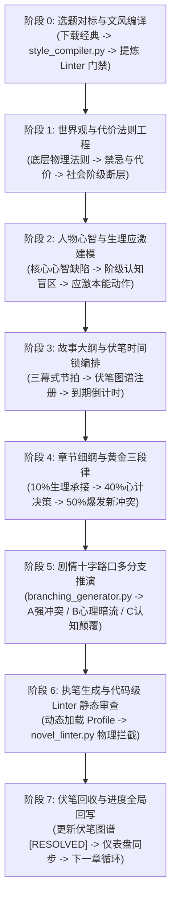

# 📖 中文长篇小说工业级创作全流程指引白皮书
*(Industrial Novel Crafting SOP & Anti-AI Framework Manual)*

> **版本**：v2.0 (Universal Decoupled Edition)  
> **适用平台**：Obsidian + Antigravity AI Agent + NovelCrafting-Plugin  
> **核心使命**：以工程化、数理化方法，根除 AI 虚构写作的“塑料味/停滞病/说教病”，实现长篇连载不吃书、人设立得住、情节有张力。

---

## 🗺️ 创作者全生命周期 7 阶深度指引全景图



---

> [!IMPORTANT]
> **人机协同第一铁律：严禁 AI 高自主性盲目生成 (User-in-the-Loop Protocol)**  
> AI 在长篇小说创作中必须作为**深度副驾、思维磨刀石与代码级质检员**，严禁脱离创作者意图自嗨生成大纲、人设或长篇正文。  
> **生成任何正式内容前，必须与创作者充分交流确定**。在从头开始创作一本新书时，必须严格遵循【五步递进对齐访谈】：
> 1. 题材对标与文风基准对齐
> 2. 世界观代价法则与底层阶级矛盾对齐
> 3. 人物心智缺陷与生理应激动作对齐
> 4. 主线三幕式与第一卷倒计时危机对齐
> 5. 获得创作者明确授权后，方可动笔撰写单章细纲与正文。

---

## 阶段 0：选题对标与文风编译 (Style Benchmarking)

任何优秀的商业长篇小说，都有明确的“读者阅读期待”与“文风节奏基准”。不要凭空让 AI 模仿抽象的“文笔好”。

### 🛠️ 执行 SOP
1. **获取同类型标杆小说全本**：
   - 探案爽文/群像拉扯 -> 对标《大奉打更人》
   - 悬疑克苏鲁/民俗疯癫 -> 对标《道诡异仙》
   - 言情轻快/现代对话流 -> 对标《微微一笑很倾城》
   - 使用下载工具：`powershell 下载小说.ps1 -Search "书名"`
2. **运行通用文风编译器**：
   - 执行：`python core/style_compiler.py --corpus "corpus/书名.txt"`
   - 自动在 `profiles/` 目录下生成同名 `.json` 与 `.md`。
3. **固化该流派的 Linter 门禁**：
   - 对话占比底线（通常 $\ge 40\%$）
   - 比喻密度上限（通常 $\le 1$ 个/400字）
   - 纯景物描写上限（通常 $\le 16\%$）
   - 突发度底线（Burstiness $\ge 0.50$）
   - 结尾哲理升华拦截：`prohibit_summary_ending = True`

---

## 阶段 1：世界观与代价法则工程 (Worldbuilding & Law of Cost)

> [!CAUTION]
> **AI 最容易犯的错误**：空洞堆砌名词设定（如“神皇历3000年，灵气复苏...”），主角获得力量毫无成本。
> **真正立住世界观的铁律**：**所有超自然力量与权力，必须绑定不可逆的生理或社会代价**。

### 📋 核心设定三问表 (自检达标才可动笔)
1. **力量的代价与异化机制是什么？**
   - *反例*：念咒语就能放火球。
   - *正例*：放火球会灼烧自己的胃壁，施法者随身必须携带生羊肉供内脏吞食（《道诡异仙》质感）。
2. **社会资源与阶级断层在哪里？**
   - 权力由谁垄断？底层百姓靠什么维持温饱？犯罪与执法的灰色地带是什么？（《大奉打更人》打更人衙门与文官集团的撕扯）。
3. **不可调和的底层矛盾引擎是什么？**
   - 整个世界正在滑向何种深渊？主角如果不采取行动，最坏的下场是什么？

---

## 阶段 2：人物心智与生理应激建模 (Character Flaws & Stress Reflex)

> [!IMPORTANT]
> **人物不可爱在于太完美，人物立得住在于缺陷与应激**。  
> 永远不要写“身高一米八，性格高冷温柔”。必须建立人物的**生理应激本能动作库**。

### 🧬 人物卡必备四要素
1. **核心心智缺陷与偏执 (Core Flaw)**：
   - 比如：极度自卑导致对他人施舍产生病态攻击性；对失控的恐惧导致强迫症式收集情报。
2. **阶级认知盲区 (Class Blindspot)**：
   - 一个底层捕快即使穿越了，看到三品大员的轿子，第一反应也是膝盖发软、下意识低头，而不是傲慢装逼。
3. **生理应激动作库 (Physical Stress Reflex)**：
   - 紧张时：不会写“他心中一紧”，而是“左手大拇指下意识刮擦刀鞘口磨损的铜皮”。
   - 动杀心时：不会写“他眼中闪过杀意”，而是“说话声音陡然低了半度，喉结缓慢滑动一下”。
   - 剧痛时：不会写“钻心的痛”，而是“后槽牙死死咬破口腔黏膜，咸腥的热血瞬间漫过舌根”。
4. **核心隐秘诉求 (Subtext & Agenda)**：
   - 表面在谈公事，实际在估算对方的破绽；表面在笑脸迎人，实际左手始终扣在袖箭机括上。

---

## 阶段 3：故事大纲与伏笔时间锁编排 (Plot Architecture & Subplot Timeline)

商业长篇小说的“防崩”与“抓人”，取决于伏笔的**节奏感与时间锁**。

### 🧵 伏笔四步生命周期模型
1. **[埋设阶段 (Plant)]**：作为一个不起眼的日常物件或随口一句话出现（如：桌角有一道新鲜的刮痕；某人咳嗽时手帕上的灰烬）。
2. **[佯谬与假象 (False Trail)]**：读者或主角给出了一个合理的错误推断（以为刮痕是搬箱子蹭的）。
3. **[催化阶段 (Catalyst)]**：数章后遇到新案件或新危机，该细节成为矛盾的关键交叉点。
4. **[回收与代价 (Resolution)]**：真相引爆，且必须带来利益或情感的剧烈重组！

### 🤖 伏笔自动化工具联动
- 在 `故事大纲/伏笔与时间线图谱.md` 中登记条目。
- 动笔前运行：`python -c "from core.plot_tracker import PlotTracker; PlotTracker().get_due_reminders(当前章节号)"`
- 系统会自动拉响警报：**“本章必须回收伏笔 #003（黑瓷瓶）或暴露暗线 #007！”**

---

## 阶段 4：章节细纲与黄金三段律 (Scene Beats & Pacing)

> [!WARNING]
> **AI 创作最致命的绝症是“慢镜头停滞”**：主角喘气洗脸喝水写了800字，剧情推进为零。  
> **单章必须遵循【黄金三段律 10% - 40% - 50%】时间压缩推进法则**。

### ⏱️ 黄金三段律时间分配
- **【前 10%：生理状态承接】**
  - 不得废话！承接上一章结局造成的**直接生理损伤、物资损耗或环境位移**。
  - 示例：“肩头的刀伤被粗布裹死，渗出的黄水黏住了衬衣。李火旺把空药瓶塞进怀里。”（直接交代伤情与物资匮乏，2句切入）。
- **【中 40%：利益心计与多方决策】**
  - 角色之间带着隐秘诉求进行台词博弈。
  - 思考下一步生路，权衡得失，定下冒险计划。
  - 严禁独白叹息，必须以“行动准备”推进（擦刀、买毒、买通眼线、伪造路引）。
- **【后 50%：意外爆发与新冲突降临】**
  - 执行计划时，必然遭遇**第三方变量破坏**或**认知外的恐怖反转**。
  - 冲突正面引爆，局面瞬间不可逆恶化。
  - **末尾必须硬切在动作、对白或具体异象上，绝对封杀一切人生哲理总结！**

### 📏 商业小说标准篇幅定标：单章 2,800 ~ 3,500 字四场次预算
很多 AI 生成的章节容易陷入“1,200 ~ 1,600 字就草草收尾”的营养不良病。在主流网文与出版商业小说中，**标准单章阅读时长应在 3~5 分钟，黄金字数在 2,800 ~ 3,500 字之间**（低于 2,200 字读者会明显感觉仓促无力）。

为了确保篇幅饱满且绝不注水，单章必须拆解为【四场次预算架构】：
1. **场次 1：状态承接与生活切入 (700 ~ 900 字)**：承接上章生理损耗，通过扎实的生活动作（算账、擦刀、买药、同伴唠叨）切入真实世界。
2. **场次 2：事件发生与对话试探 (800 ~ 1,000 字)**：各方带着潜台词多轮拉扯（至少 3 轮推拉），不轻易让对方顺从，展现心理摩擦力。
3. **场次 3：危机升级与转折爆发 (800 ~ 1,000 字)**：意外闯入打破平衡，正面动手或暗牌揭露，生理应激本能动作全面引爆。
4. **场次 4：局势收紧与断章硬切 (500 ~ 700 字)**：局势不可逆改变，付出代价，在最关键的动作或物象上戛然而止。

> **💡 扎实扩写、拒绝注水的核心心法**：
> 扩充字数绝不是靠大段景物描写（纯景物严控 $\le 16\%$），而是靠**“增加人物互动的阻力”**（彼此怀疑、隐瞒、试探）、**“细化物理动作链条”**（受力反弹、失误、临时变招）、以及**“还原市井生活细节”**（具体银钱数目、道具磨损程度、周围路人的警惕反应）。

---

## 阶段 5：剧情十字路口多分支推演 (Branching Deductive Engine)

当剧情推进到关键节点、或者你陷入卡文不知如何推进时，启动**多分支推演引擎**。

### 🎲 3 种张力差异化走向
- **分支 A【强冲突正面硬刚】**：
  - 打破一切伪装，直接掀桌子，将潜藏矛盾推向生死血拼。
- **分支 B【心理暗流与利益合谋】**：
  - 表面妥协认怂，私下达成带血的利益互换，暗中互扣人质或把柄。
- **分支 C【认知颠覆与荒诞转折】**：
  - 引入更高维度的世界观法则或第三方势力介入，彻底颠覆现有的游戏规则。

使用方式：
```bash
python -c "from core.branching_generator import generate_branches; generate_branches('情境描述', '核心诉求')"
```

---

## 阶段 6：执笔生成与代码级 Linter 静态审查 (Dynamic Prose & Linter)

### 🛑 物理级防 AI 塑料味铁律对照表

| 严禁出现的 AI 塑料味通病 | 物理替代法则 (How to Fix) |
| :--- | :--- |
| **严禁抽象情绪滥调**<br>“钻心的痛”、“心中一紧”、“骇然”、“倒吸一口凉气” | **转化为生理动作或冷硬感官**<br>“牙齿咬得下唇渗血”、“胃部剧烈抽搐”、“后脑头皮发紧发麻” |
| **严禁空洞机械比喻**<br>“像生锈的冰锥子”、“像大山一样沉重” | **严控比喻 $\le 1$ 个/400字**，直接描写质感与事实，不借物喻人 |
| **严禁段尾人生导师式升华**<br>“只要...就总有...”、“这就是残酷的人生”、“不仅...更是...” | **段末必须硬切在动作或台词上**<br>反例：“总有一天他会撬动这座大山。”<br>正例：“李火旺反手扣上门闩，插上铜销，吹熄了油灯。” |
| **严禁纯景物注水**<br>大段空泛描写“残阳如血”、“月光洒在青石板上” | **景物占比 $\le 16\%$**，环境必须绑定人物互动（“他靴底碾碎枯枝的脆响”、“雨水顺着盔甲缝隙灌进后颈”） |
| **严禁句式单调对称**<br>每句长度均在 15~18 字之间 | **保持突发度 (Burstiness) $\ge 0.55$**，单字断句、短句连续冲锋，夹杂长句信息交代 |

### 🛠️ 执笔后一键质检
```bash
python -c "from core.novel_pipeline import NovelPipeline; NovelPipeline().print_critique_report(open('草稿.txt', encoding='utf-8').read())"
```
只有静态 Linter 评分达到 **90 分以上且 0 处违规**，方可归档入库。

---

## 阶段 7：伏笔回收与进度全局回写 (Status Writeback & Loop Closure)

写完章节并通过质检后，绝不是结束，必须完成**创作工程闭环**：
1. 将正文保存至对应章节草稿，如 `章节草稿/第十五章_夜探义庄.md`。
2. 若本章已回收某伏笔，在 `故事大纲/伏笔与时间线图谱.md` 中将状态由 `[PLANTED]` 改为 `[RESOLVED]`，记录回收章节与效果。
3. 更新 `创作仪表盘.md` 的当前字数、连载状态与下一步任务指引。

---

## 🤝 Antigravity Agent 人机交互指令标准

当你与 Antigravity 对话创作时，可以使用以下高效意图指令：

- **`我要开新书`**：Agent 会启动引导问询，带你梳理世界观代价、核心人设缺陷与对标作品。
- **`准备写第 X 章`**：Agent 自动扫描到期伏笔、前章遗留状态，为你制定 10%/40%/50% 细纲。
- **`这步卡文了，推演分支`**：Agent 调用分支引擎给出 A/B/C 三条反套路抉择。
- **`审查这段草稿`**：直接把草稿发给 Agent，后台启动 Novel Linter 执行代码级体检并给出重写方案。
- **`查一下伏笔库`**：查看当前尚未回收的所有暗线与危险红线。
