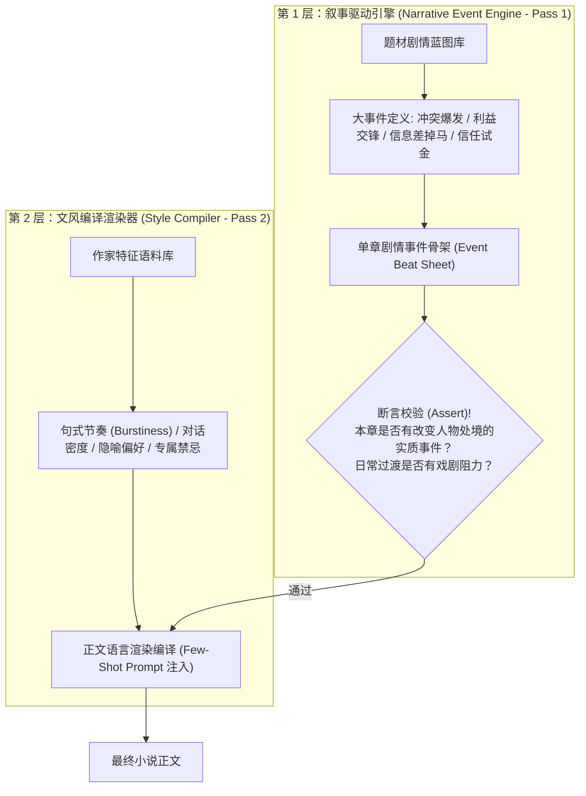

# 📖 通用小说工程化工具 (Novel-Crafting Engine) 工业级设计指南与架构规范

> **版本**：v3.0 (Industrial Universal Edition)  
> **设计使命**：适配都市言情、仙侠修真、悬疑惊悚、科幻无限流等任意题材。将实战中暴露的病灶抽象为**通用软件架构、跨章节算法质检与人机协同协议**，彻底根除“文风与骨架混淆”、“跨章节结构克隆（土拨鼠之日）”与“AI 假大空塑料味”。

---

## 🏛️ 一、 核心架构解耦：分离“叙事驱动引擎”与“文风渲染编译器”

> **核心教训**：AI 最致命的通用缺陷是**“文风与骨架混淆”**——它以为给它一段名家语料，就是让它套用该语料的遣词造句，去机械描写毫无波澜的琐碎日常（玄幻在打坐采药、言情在打本逛街、悬疑在点烟叹气）。



### 通用工具设计规范：
1. **严格双层流水线（Two-Pass Pipeline）**：
   - **Pass 1（剧力推进层）**：只推演“人物博弈、信息增量、利益冲突、意外反转”。工具在此阶段必须强制断言（Assert）：**“本章是否存在至少一个改变人物处境或心理状态的核心事件？若是日常任务或过渡，其戏剧阻力是什么？”**
   - **Pass 2（文风渲染层）**：将骨架输入给挂载的文风 Profile（如顾漫风、狐尾风、卖报风、猫腻风）进行特征编译，只负责修辞、节奏、句式与情绪基调。
2. **禁止单阶段黑盒端到端生成**：严禁直接向 LLM 发送“用某某风格写第 X 章”的笼统指令，必须先输出分镜事件卡，再输出渲染正文。

---

## 🛰️ 二、 宏观质检算法：构建跨章节“反土拨鼠之日”纵向审查器

> **核心教训**：现有的 Linter 多局限于“单章静态审查”，能测字数和敏感词，却**无法发现跨章节的结构复制粘贴**（例如每章开篇都在吃东西、每章结尾都在看窗外喝茶）。

### 1. 跨章节首尾段向量余弦相似度审查（Head/Tail Semantic Collision Detector）
- **算法逻辑**：
  - 工具自动切片每一章的前 10%（起手式）与后 10%（收口式），生成 N-gram TF-IDF 语义向量；
  - 计算第 $N$ 章与第 $N-1$、$N-2$ 章首尾段的余弦相似度（Cosine Similarity）；
  - **阈值门禁**：若相似度 $> 0.65$ 或命中连续套路模式（例如连续出现“喝水/看窗外/叹气”或“清晨醒来/打卡上班”），触发 `【跨章结构同质化告警 (Structural Homogenization Error)】`，强制推翻收口方式。

### 2. 时间-空间拓扑分布校验器（Spatio-Temporal Diversity Index）
- **状态机追踪**：
  - 工具维护一个状态机，自动提取各章的时间戳与主场景空间（封闭微观空间/公共社交场域/野外未知探索）；
  - **规则硬约束**：
    - **空间连续阈值**：禁止连续 3 章发生在同一封闭微观场景（如连续 3 章都在主角书房/洞府/工位）；
    - **时间弹性阈值**：严禁按“日历打卡”推进。一卷中必须包含“事件高度浓缩的高潮日”与“一笔带过的时间跳跃”。

---

## 🛡️ 三、 微观通用红线：代码级 Linter 静态质检规则库

面向全题材通用的静态代码审查规则（代码实现于 `core/novel_linter.py`）：

```python
UNIVERSAL_LINTER_RULES = {
    # 1. 抽象情绪滥调拦截器 (Emotion Abstract Trap)
    "abstract_emotion_patterns": [
        (r"(?:钻心的痛|钻心之痛|痛彻心扉|痛，太痛了)", "情绪悬浮，必须替换为神经反射、冷汗、肢体抽搐等冰冷生理反应"),
        (r"(?:心中一紧|心中一震|心中大骇|心头猛然一紧|咯噔一下)", "泛滥心跳滥调，必须替换为视线凝固、呼吸阻滞、停下动作等外在事实"),
        (r"(?:倒吸一口凉气|倒吸凉气|瞳孔骤缩|骇然失色)", "网文机械模板词，严禁使用")
    ],

    # 2. 人生导师式鸡汤升华拦截器 (Life-Coach Preach Trap)
    "philosophical_ending_patterns": [
        (r"(?:这就是人生.*|只要.*就总有.*|不仅是.*更是.*|或许，这就是.*的意义)", 
         "严禁段末/章末说教升华。章节结尾必须硬切在物理动作、悬念对白或具体道具器物上")
    ],

    # 3. 悬浮无增量修辞拦截器 (Metaphor Density & Scale)
    "metaphor_constraints": {
        "max_density_per_kilo_words": 2.5,  # 每千字比喻数 <= 2.5 个
        "forbidden_cliche_metaphors": [
            r"像生锈的.*冰锥", r"如大山一般", r"像断了线的风筝", r"如同决堤的洪水"
        ]
    },

    # 4. 镜头锚定度检测 (Scenery Water Ratio)
    "max_scenery_sentence_ratio": 0.15,  # 严格控制在 15% 以下，镜头必须死死锁定人物动态交互

    # 5. 语言节奏突发度 (Sentence Burstiness)
    "min_burstiness_score": 0.60  # 突发度必须 >= 0.60，多用短句、单字行与打断式对白
}
```

---

## ⏱️ 四、 节奏控制：单章“物理分场与字数刚性预算机制”

商业类型小说单章（2,800 ~ 4,000 字），强制套用**通用四场次物理刚性预算**：

| 场次 | 结构定位 | 篇幅配额 | 核心任务与物理门禁 |
| :---: | :--- | :---: | :--- |
| **Scene 1** | **生理承接与切入** | 20% (~600-800字) | 承接上章消耗、位置与生理状态。**严禁慢镜头洗脸、发呆、叹气等无效动作，直接在冲突准备或行动中切入。** |
| **Scene 2** | **多方交锋与信息差** | 30% (~900-1100字) | 人物登场碰撞（台词博弈、信息试探、利益交换）。**必须产生实质信息增量或认知反差。** |
| **Scene 3** | **矛盾升级与行动决断** | 30% (~900-1100字) | 局势突变或计划受阻，主角做出带有代价的决策，进入动作推进或正面较量。 |
| **Scene 4** | **悬念断章与物理硬切** | 20% (~500-700字) | 拒绝人生感叹！**镜头必须定格在突发异象、未发出的消息、敲门的声响、递出的物品或关键决断台词上。** |

---

## 🤝 五、 人机协同协议：多阶段递进式对齐工作流 (Universal Alignment SOP)

剥夺 AI 自作主张直接生成全卷正文的权限，建立标准三阶漏斗：

```text
[阶段 1：卷级大事件对齐]
   AI 列出本卷关键拐点大事件（必须含：引爆点、外部施压、信息差揭示、情感/利益危机、破局大结局）
   ➔ 【创作者确认/修改】
   ▼
[阶段 2：单章分镜事件卡对齐 (Pass 1)]
   动笔前输出本章：核心事件、戏剧阻力、信息差、四场次剧情细目、收尾硬切定格点
   ➔ 【创作者确认/修改】
   ▼
[阶段 3：文风渲染与代码级自动化质检 (Pass 2)]
   生成正文 ➔ 自动触发微观 Universal Linter 与宏观跨章 Longitudinal Linter 跑分 ➔ 若未达 100 分自动自愈修复 ➔ 交付创作者
```
